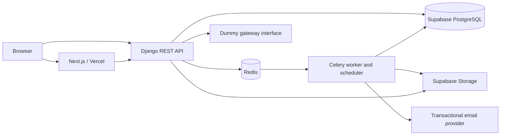

# System design

Status: approved design baseline, 2026-10-07. Unresolved later-phase behavior is listed in ADR 0001. This document describes the intended full implementation; Phase 0 delivery status is recorded separately in `11-phase-0-review.md`.

## Architecture

Single repository, `backend/` and `frontend/`. Django apps: accounts, events, teams, orders, payments, tickets, checkin, notifications, reports, core. Views validate and authorize; service functions implement state transitions and transactions. PostgreSQL is the inventory authority. Redis coordinates background work and throttling, never seat availability.

Next.js server-renders public event details and metadata. Live availability is revalidated at checkout and never trusted from cached HTML. Restricted screens and APIs use private/no-store responses. Local development uses PostgreSQL and Redis with Docker Compose; SQLite must not stand in for concurrency validation. Python 3.12 is required by the brief; the installed Python launcher has not yet been validated as a usable 3.12 runtime.

## Data model based on all fourteen ERD entities

| Entity | Fields and relations |
|---|---|
| User | UUID; unique normalized email; Django password field; full_name, phone, global role, email_verified, created_at |
| OtpCode | Email, purpose, nullable order FK, code_hash, expires_at, attempts; proposed consumed_at and challenge binding |
| Event | UUID; owner FK; title, unique slug assigned on approval, description, venue, banner storage key, UTC event and sales intervals, max_per_order, collect_attendee_names, status, rejection_reason, reviewer FK and reviewed_at |
| EventFormField | Event FK, stable ID, label, type, required flag, options JSON, sort_order |
| TicketCategory | Event FK, name, decimal BDT price, nullable seat_limit, sold_count, is_active |
| TeamMember | Event and user FKs; manager/scanner/viewer role; added_at; unique(event,user) |
| Invitation | Event and inviting user FKs; normalized email, role, unique token, status, expires_at; propose storing token digest and adding revoked status |
| Order | UUID; unique order_number; event FK; nullable buyer user; buyer_email, recipient_email, is_gift, total_amount, status, custom_answers JSON, private PDF storage key, created_at |
| SeatHold | Order/category FKs; positive quantity; expires_at, active/converted/released status |
| Payment | Order FK; provider, phone, amount, status, gateway_ref, otp_verified_at; every attempt retained |
| Ticket | UUID; unique readable code and cryptographically random QR token; order/category FKs; attendee_name, recipient_email, status, used_at, used_by FK |
| CheckInLog | Nullable ticket FK, event FK, scanner FK, qr/manual method, result, scanned_at; no raw scanned tokens in logs |
| Notification | Recipient user FK, nullable event FK, type, message, is_read; propose created_at |
| AuditLog | Actor FK, action, target type/ID, safe details JSON, created_at |

Use Django's password hashing rather than a separate custom password_hash implementation. Money uses fixed-precision decimals, never binary floats. Positive quantities and max-per-order, nonnegative prices/counts, end-after-start intervals, and used-state attribution require validation and applicable database constraints. Validate sales_end <= event end; confirm more restrictive scheduling rules before adding them.

Foreign keys preserve payment, ticket and attendance history using protective deletion where required. Index event slug, ticket token/code, membership(event,user), order(event,status,created_at), normalized buyer email, hold(category,status,expires_at), and invitation token/expiry. Unique constraints also provide indexes; avoid redundant ones.

Additional internal fields proposed for reliable operation: order checkout authorization token digest, checkout idempotency key, snapshot of selected categories/prices/attendee names/custom field labels, PDF/email generation states, payment idempotency reference and timestamps. These are technical additions to the base ERD, to be reviewed before migrations. Store asset keys rather than permanent public PDF URLs. A periodic reconciliation job can requeue paid orders lacking PDFs/emails after a queue outage; use stable delivery keys to reduce duplicates.

The category and order of every ticket is fixed on purchase. A snapshot prevents later field/label changes from altering historical answers. Check category.event == order.event in services; ordinary foreign keys alone do not enforce that cross-table invariant.

If any active category is unlimited, event capacity and unsold capacity display as Unlimited, not a misleading finite sum. Sales/revenue history includes cancelled tickets; attendance separates cancellation from no-show (proposed rule).

## State transitions

- Event: Draft -> Pending -> Approved or Rejected; Rejected -> Draft -> Pending. Approval generates a unique readable slug. On sale and Sales closed derive from approved status plus UTC sales boundaries; enforce boundaries on every write, even if scheduler runs late. Explicit owner close ends the event; report job completion exposes Report ready. Approved event edits are blocked in MVP until V2 edit rules exist.
- Order: Pending -> Paid, Failed or Expired. A terminal failed/expired order requires a fresh hold/order to retry. Paid is terminal; repeated successful verification returns the original result.
- Hold: Active -> Converted only when order becomes Paid; Active -> Released on failure or expiry. Server clock is authoritative; expiry uses `expires_at <= now`.
- Payment attempt: Initiated -> Success or Failed. Invalid OTP handling and permitted retry count must be documented in the dummy gateway contract; terminal failure releases all order holds.
- Ticket: reservation represented by SeatHold (proposal); issued Valid -> Used or Cancelled. Owner cancellation and scanning serialize so a used ticket is not silently rewritten.
- Invitation: Pending -> Accepted, Expired or Revoked (proposed enum extension). Acceptance requires verified account email equal to invited email.

## Inventory and payment concurrency

1. Checkout service validates event state, category membership, quantities, dynamic answers and server-calculated prices. The user confirmed both per-order and per-email/event limits. Normalize buyer email consistently with account email; gifts count against the buyer, not the recipient. Do not apply provider-specific dot/plus alias rewriting.
2. In one transaction lock the Event row, then all selected TicketCategory rows in stable UUID order. This conservative MVP lock order serializes inventory mutations within an event and makes event closing versus payment deterministic. Measure contention before narrowing locks.
3. While holding the Event lock, sum this buyer email's paid order quantities and pending unexpired hold quantities across all categories. Require this sum plus the new quantity <= the event maximum, and new quantity <= the per-order maximum. Capacity per category is seat_limit - sold_count - sum(active holds whose expiry is in the future). Create order and holds together, with a server-generated ten-minute deadline. Expired rows need not be deleted to stop counting them. The event lock serializes competing orders for the same email even when they select different categories. Failed/released/expired orders do not count; paid cancelled tickets continue to count under the proposed cancellation policy.
4. Every inventory mutation follows the same lock order: Event, categories sorted by ID, Order, Payment/Holds. For an existing order read immutable category references first, acquire those locks, then recheck current state. Close, failure, expiry and payment conversion must share this discipline.
5. Payment confirmation rechecks pending order, current hold expiry, sales eligibility and amount. Convert holds, increment sold_count, create exactly quantity tickets, mark payment/order successful in the same transaction. An expired or released hold cannot issue tickets. No external network calls while holding database locks.
6. Unique idempotency keys and locked order state prevent duplicate orders or ticket issuance on retries. A terminal response is replayed without creating new side effects.
7. Queue generation after database commit. Periodic reconciliation repairs missed task dispatch. PDF and delivery jobs are retryable and idempotent where possible; transactional email is not claimed to be exactly-once without provider support.

Tests run against PostgreSQL with separate connections and synchronized competing transactions: last-seat race, same normalized email racing across different categories, aggregate paid-plus-held cap, expired holds restoring email allowance, multi-category purchase, repeated payment verification, payment versus expiry, and close versus payment. Assert final order, payment, hold, sold count and ticket count together.

## Check-in concurrency

Check event-scoped permission before lookup. Use atomic conditional update where ticket status is Valid, setting Used, used_at and used_by. Exactly one concurrent scan gets an updated row. Losers reread the committed record for Already used time and scanner. Write a CheckInLog for every authorized scan attempt, including invalid, wrong-event and cancelled, inside the same transaction as any state change. Unauthorized endpoint access is logged as a security event, without accepting arbitrary event IDs as scan logs.

Wrong-event responses disclose no other event's attendee details. Scanner responses contain only ticket code, attendee name, category, result and relevant usage time/identity. Manual codes are random and rate-limited. Tests include double-scan races, cancellation race, role revocation and cross-event access.

## Permission matrix

| Action | Admin | Owner | Manager | Scanner | Viewer |
|---|---|---|---|---|---|
| Approve/reject | Yes | No | No | No | No |
| Edit draft/rejected event | No | Yes | Yes | No | No |
| Manage team | No | Yes | No | No | No |
| Dashboard/report | Yes | Yes | Yes | No | Yes |
| Check in | No | Yes | Yes | Yes | No |
| Attendee list | Yes | Yes | Yes | Scan result only | No |
| Cancel ticket (proposal) | No | Yes | No | No | No |
| Close event (proposal) | No | Yes | No | No | No |

Admin is not an implicit bypass for scanning or editing. Revalidate membership on every request; do not embed durable team permissions in JWTs. Invitation acceptance does not allow self-assignment of owner/admin roles.

## API contract outline

Base `/api/v1/`. JSON errors: `{ "error": { "code": "...", "message": "...", "fields": {} } }`. Lists are paginated; validation, unauthenticated, forbidden, missing, conflict, expired and throttled errors have consistent status codes. OpenAPI is generated with drf-spectacular.

| Routes | Access / intent |
|---|---|
| `GET health/` | Minimal health; separate private readiness checks |
| `POST auth/register, login, refresh, logout` | Cookie authentication; throttled; CSRF on unsafe cookie-authenticated requests and login |
| `POST auth/verify-email/request, confirm` | Challenge-bound verification |
| `POST auth/password-reset/request, confirm` | Generic response; single-use expiring link |
| `GET/PATCH auth/me`; `POST auth/change-password` | Current user only |
| `GET/POST events/`; `GET/PATCH events/{id}/` | Event-scoped organizer/team permissions |
| `POST events/{id}/submit`; `GET events/{id}/preview` | Verified owner/manager; private draft preview |
| `GET/POST events/{id}/categories, form-fields` | Owner/manager; draft/rejected only; detail PATCH/DELETE equivalents |
| `GET admin/events`; `POST admin/events/{id}/approve, reject` | Admin only; transactional transition and audit |
| `GET public/events`; `GET public/events/{slug}` | Public approved content; no buyer data or private preview leaks |
| `POST orders/`; `GET orders/{id}/status` | Checkout validation; guest capability or authorized account |
| `POST orders/{id}/payments`; `POST payments/{id}/verify` | Bound to checkout authorization; idempotent state changes |
| `GET orders/{id}/download` | Authorized buyer checkout/account or verified recipient; private PDF; preparation status until ready |
| `POST ticket-recovery/request, verify, resend` | Email proof, generic anti-enumeration responses and limits |
| `GET events/{id}/attendees`; `POST tickets/{id}/cancel` | Matrix permissions; audit cancellation |
| `POST events/{id}/check-ins`; `GET events/{id}/attendance` | Owner/manager/scanner; scoped minimal counter |
| `GET/POST events/{id}/invitations`; `POST invitations/accept` | Owner creates; matching verified invitee accepts |
| `GET/PATCH/DELETE events/{id}/members/{member}` | Owner manages; revocation immediate |
| `GET events/{id}/dashboard, report`; `POST events/{id}/close` | Matrix permissions; close owner only proposal |
| `GET notifications/`; `POST notifications/{id}/read` | Current recipient only |

Exact route schemas will be versioned in Phase 1 before client integration. Gift email delivery sends the PDF to the recipient and receipt to the buyer. Per MD confirmation requirements, an authorized buyer checkout also permits ticket viewing/download. Recipient recovery requires proof of the recipient email. Knowing an order UUID or email is never authorization.

## Security, jobs and files

JWT access/refresh cookies are httpOnly and Secure in hosted environments. Implement explicit CSRF checks for custom cookie-JWT authentication, including refresh/logout; DRF JWT authentication does not automatically gain session CSRF enforcement. Strict allowed origins and hosts. Prefer sibling custom domains; verify SameSite and browser behavior before deployment. In-memory demo sessions are not production auth.

OTP codes are hashed, purpose-bound, expiring, single-use and attempt-limited; do not log them. Dummy payment behavior is explicitly simulated and disabled as a real-payment claim. Rate-limit login, recovery, OTP, checkout and scanning using a shared backend. Passwords use Django/Argon2. Image uploads are size-limited, type-checked and re-encoded. PDF assets use trusted local/downloaded sanitized resources; block arbitrary URLs to avoid server-side fetch abuse.

Storage interface supports banner writes, private PDF writes and short-lived authorized reads. Payment interface: initiate(order), verify_otp(payment, otp), status(payment). Local development can use filesystem storage and console email adapters; hosted acceptance requires Supabase and a transactional provider. Celery processes PDF/QR generation, delivery, notifications, expiry and reports, with retry/backoff and visible failure states. One order PDF contains one page per ticket; QR minimum 35 mm, black on white, no decoration. HTML mock-up approval precedes PDF module development.
